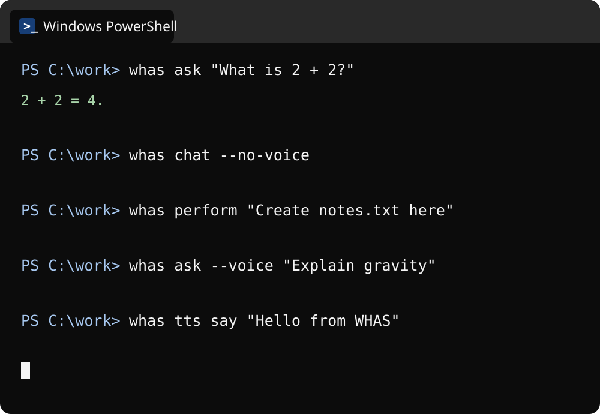
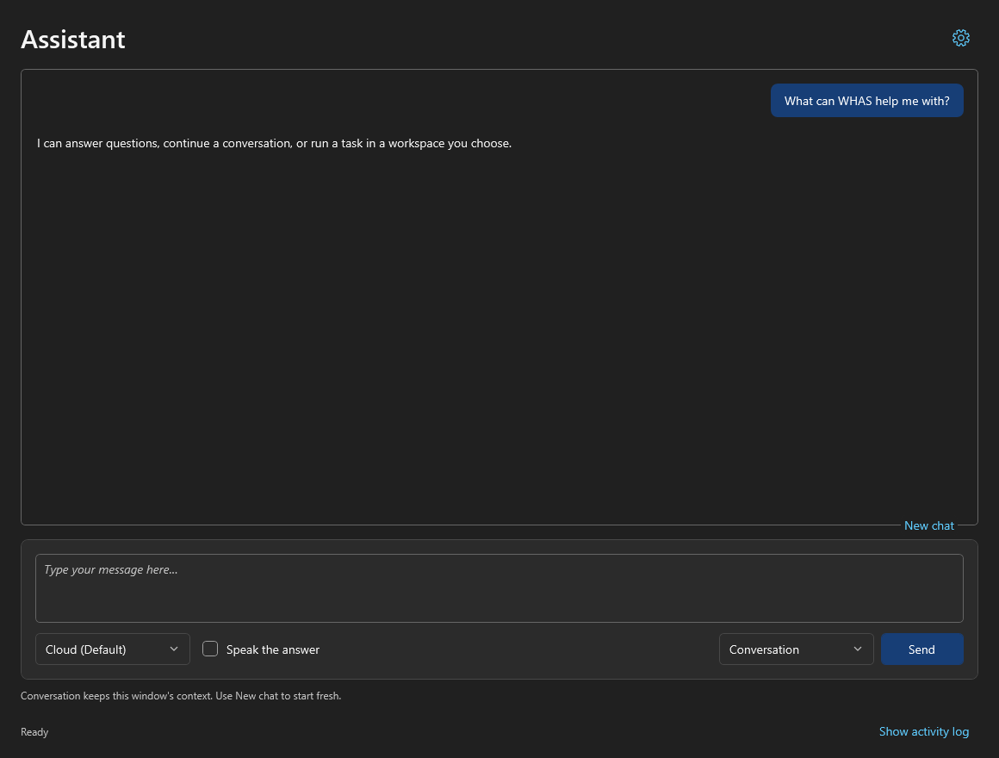

# Windows Hybrid Agentic Stack

A Windows AI toolkit for cloud and local agents, with optional local speech.
Use OpenCode with your chosen cloud provider, Ollama for local models, and
Chatterbox Turbo, Piper TTS or F5-TTS for text-to-speech.

Targets **Windows 10/11 and Windows PowerShell 5.1**. Install only the components
you need. Installed commands use native launchers and require no PowerShell
profile or execution-policy changes.

## Get started

- [Quickstart](docs/quickstart.md) — get the project, check prerequisites and run your first commands.
- [Installation guide](docs/installation.md) — detailed setup, configuration, usage and uninstall instructions.

Download the repository ZIP, extract it and double-click **`whas-gui.exe`**
for guided setup. The same app provides usage, settings and removal afterward.
For PowerShell setup, use the included `install.ps1` instead.
Versioned EXE and ZIP downloads are available from
[GitHub Releases](https://github.com/thestonefox/windows-hybrid-agentic-stack/releases).
The EXE is unsigned, so Windows may display an unrecognized-app or unknown-publisher
warning. See [EXE setup and verification](docs/installation.md#standalone-executable-setup).

## Two ways to use WHAS

After setup, use PowerShell commands or open `whas-gui.exe`. The terminal
preview uses a generic `C:\work` folder; choose your own folder before running
a task that reads or writes files.

| PowerShell | Graphical app |
|---|---|
| <a href="docs/images/cli-terminal.svg"></a><br>[CLI guide and all flags](docs/cli.md) | <a href="docs/images/gui-conversation.png"></a><br>[GUI guide](docs/gui.md) |

## Commands

**[All CLI commands and flags](docs/cli.md#complete-command-and-flag-reference)**
— request options, settings, speech, models, sessions and setup/removal options.

```powershell
whas --help
whas tts --help
tts-help
```

`tts-help` matches the standalone `tts-start` / `tts-say` command family.
There is no bare `tts` command. New help commands require the updated installed
command layer; use [shared app repair](docs/gui.md#use-and-configure) after updating.

| Command | Purpose |
|---|---|
| `whas ask`, `whas askl`, `whas askc` | One-off questions without file or system tools |
| `whas chat`, `whas chatl`, `whas chatc` | Contextual conversations |
| `whas perform`, `whas performl`, `whas performc` | Independent tasks with file and system tools |
| `whas configure` | Shared CLI and GUI settings |
| `whas tts say` | Generate and play speech locally |

Cloud commands inherit your OpenCode model selection by default. Add `--voice`
to `whas ask` or `whas perform` to speak its response. In the GUI, local chat
uses Ollama directly and keeps conversation history in the window; Run a task
uses OpenCode for file and system tools. CLI conversations use OpenCode sessions.

Open the repository or installed `whas-gui.exe` for graphical use. Both find
the registered installation and its configuration. Opening a newer repository
EXE does not update an older installed EXE or command layer; see
[updating the app](docs/gui.md#use-and-configure).
Older launchers remain available for [compatibility](docs/cli.md#compatibility-commands).

## Documentation

- [Troubleshooting](docs/troubleshooting.md)
- [Unified commands and shared settings](docs/cli.md)
- [Graphical setup, usage and configuration](docs/gui.md)
- [Agent runtimes, sessions and strategy authoring](docs/agent-strategies.md)
- [TTS engine management and strategy authoring](docs/tts-strategies.md)
- Engine guides: [Chatterbox](docs/tts/chatterbox-turbo.md), [Piper](docs/tts/piper-tts.md), [F5](docs/tts/f5-tts.md)
- [Builds and releases](docs/releases.md)
- [Installation testing and rollback](docs/install-test-rollback.md)

## Development

Changes are tested locally and in Windows Sandbox. Commit messages use scoped
[Conventional Commits](https://www.conventionalcommits.org/), with every line
limited to 72 characters.
Successful updates to `main` automatically create a semantic version tag and a
release with grouped commit notes, an EXE, ZIP and checksums. See the
[release rules and retry instructions](docs/releases.md#automatic-semantic-releases).

## License

See [LICENSE](LICENSE). Agent runtimes, TTS packages and models have their own licenses; see
[TTS strategies](docs/tts-strategies.md), including the noncommercial restriction
on F5 pretrained weights.
